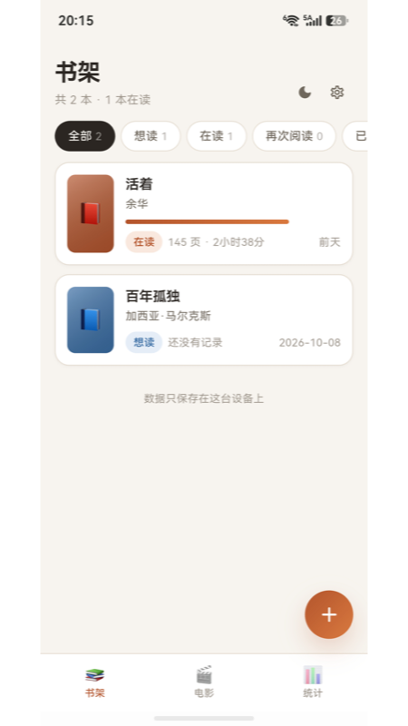

# 书影温故阅读与观影记录软件操作说明书

版本 V1.0

> 内部参考稿，不可直接作为符合无 AI 承诺的登记材料。本文件由 AI 根据源码辅助整理。2026年10月22日核验的协会转载及高校说明，均指向2026年3月15日版权中心通知和新版申请表中的无 AI 承诺，范围涉及代码、文档及申请材料。应先向版权中心如实说明开发和编制过程并取得适用口径；改写措辞、改格式或保留 Git 历史不能自动满足该承诺。相关出处和核实边界见附录。本提示属于编制说明。

## 1 软件概述

书影温故阅读与观影记录软件是一款个人记录管理应用，界面名称为“书影温故”，英文名称为 Reel&Read。软件用于整理个人书架和片单，保存阅读、重读及多次观影经历，并汇总阅读与观影统计。

软件以书籍、阅读轮次、阅读记录、电影和观看记录为主要管理对象。一部作品可以对应多次阅读或观看，便于用户区分不同时间发生的经历。软件不提供书籍正文、电影播放、影视下载或作品检索服务，作品资料由用户自行填写。

本说明书说明 V1.0 的日常操作，供使用者了解新增作品、登记活动、查看统计、备份迁移及设置功能。说明以当前国内 Android 版本的界面和共有功能为主。iOS 和 HarmonyOS 具有相应实现，但支付、系统文件选择及界面表现可能不同，应以本次申请所对应的实际构建为准。

软件名称、版本和申请信息须在最终定稿时统一。V1.0 为拟登记版本标识，不替代手机“关于”中显示的实际版本及构建号。

## 2 使用准备

### 2.1 安装和启动

在支持该软件的移动设备上安装相应平台的应用包，安装完成后点击“书影温故”图标启动。无需注册应用账号即可使用基础记录功能。系统兼容范围应以最终安装包实际支持和验收结果为准。

首次启动时，按界面提示阅读隐私政策。用户确认同意后进入主界面；不同意时按提示退出或停止使用。后续可从设置页再次查看政策或撤回同意。

【待补图1：本次申请构建的首次启动隐私提示，必须来自真实运行界面。】

### 2.2 主界面导航

主界面底部包含“书架”“电影”“统计”三个入口。点击对应入口切换页面。书架和电影页面的右下角提供加号按钮，用于新增相应类型的作品；统计页面用于查看汇总信息。

书架右上角的主题按钮用于切换深浅外观，设置按钮用于进入设置页。首次使用时列表为空，用户按页面提示新增书籍或电影。

## 3 书架管理

### 3.1 查看书架

点击底部“书架”进入书籍列表。页面顶部显示书籍数量和在读数量；列表卡片显示书名、作者及当前记录状态，已有阅读活动的书籍还可显示进度、累计时长等信息。

点击“全部”“想读”“在读”“再次阅读”“已读”标签，查看相应状态的书籍。标签横向显示不完整时可横向滑动。书籍状态随阅读轮次和完成情况变化，不需要用户另外重复建立同一本书来记录重读。

图中数据用于演示界面。此图来自历史构建，最终提交前应核对是否与申请版本一致，必要时重新截取。

### 3.2 添加书籍

1. 在书架页面点击右下角加号，打开“添加书籍”。
2. 填写“书名”和“作者”，这两项为必填内容。
3. 根据实际情况填写“总页数”，选择封面样式和主题色，并填写备注。
4. 点击“加入书架”。保存成功后返回列表，查看新书籍卡片。

总页数用于辅助显示阅读进度，应按实际书籍填写。备注可记录加入书架的原因或个人提示，不用于在线发布。缺少必填信息时应按界面提示补齐后保存。

【待补图2：添加书籍表单，展示书名、作者、总页数及保存按钮。】

### 3.3 编辑和删除书籍

点击书籍卡片进入详情页，通过编辑入口打开“编辑书籍”。修改信息后点击“保存修改”，返回详情核对内容。

删除书籍时，先阅读确认提示再决定是否删除。删除操作会影响该书籍及关联记录，操作前应导出备份。误删后能否恢复取决于是否保留了可用备份，不应把删除视为可随时撤销的操作。

## 4 阅读记录与多轮阅读

### 4.1 开始阅读

在尚未开始阅读的书籍详情页点击“开始阅读”，建立当前阅读轮次。开始后可查看该轮累计页数、阅读时长及记录条数。

### 4.2 记录本次阅读

1. 在书籍详情页点击“记录本次阅读”。
2. 设置实际阅读时间。
3. 按实际情况填写本次阅读页数或阅读时长，并查看表单中的预计总进度。
4. 可填写本次阅读备注。
5. 点击“保存记录”，返回详情页核对本轮统计和记录列表。

页数和时长以实际活动为准，预计进度用于辅助判断，不替代用户对真实阅读情况的确认。保存后若出现保存失败提示，应保留当前信息并按提示处理，不应直接卸载软件。

【待补图3：阅读记录表单。】

【待补图4：包含多条阅读记录的书籍详情页。】

### 4.3 完成本轮与再次阅读

本轮阅读结束后点击“读完了”，核对确认提示后完成该轮。再次阅读同一本书时，点击“再读一次”建立新的轮次。新一轮独立累计活动数据，历史轮次仍可查看。

例如，同一本书首次阅读结束后，用户可在数月后建立第二轮阅读。这样可以分别保留两轮的时间、页数及阅读记录，而不是覆盖第一次阅读的数据。

### 4.4 补记往期阅读

需要登记以前已经完成的阅读经历时，在详情页点击“补记往期”。按实际情况填写开始日期、完成日期、累计页数、累计时长和备注，点击“保存这一轮”。该功能用于补录历史轮次，不应重复录入已经保存的同一段经历。

### 4.5 管理记录和轮次

用户可通过详情中的相应操作入口修改或删除阅读记录，并查看历史轮次。删除单条记录和删除整个轮次的影响范围不同，应先查看确认提示。完成操作后返回详情及统计页核对结果。

【待补图5：历史轮次或补记往期表单。】

## 5 电影与观影记录

### 5.1 添加和编辑电影

1. 点击底部“电影”进入片单。
2. 点击右下角加号打开“添加电影”。
3. 填写必填的“电影名称”和“导演”，可补充上映年份与备注。
4. 点击“加入片单”，返回列表查看新条目。
5. 进入电影详情后可编辑资料，修改完成点击“保存修改”。

电影资料是用户自行维护的记录，不表示软件提供对应影视作品的播放或下载。

【待补图6：本次申请构建的电影列表。】

### 5.2 标记看过和再次观看

进入电影详情，首次登记观看时点击“标记为看过”；已有观看记录时点击“再看一次”。在表单中填写观看时间，设置评分并按需要添加备注，然后点击“保存”。

详情页汇总观看次数、平均评分和最近观看时间，并列出各次观看记录。同一电影的多次观看应分别登记，便于保留每次活动的时间和感受。

### 5.3 删除观影记录与电影

通过详情页的操作入口管理单次观影记录。删除记录前核对所选时间和内容；删除整部电影前先备份，并确认是否需要同时移除其关联记录。操作完成后核对次数及评分汇总。

【待补图7：电影详情及观影登记表单。】

## 6 统计与年度回顾

### 6.1 基础统计

点击底部“统计”，查看读完次数、阅读时长、累计页数、书架书籍数、电影收藏数和观影次数。页面还提供近期阅读趋势和动态信息，具体内容取决于已经保存的阅读与观影记录。

统计以本机数据为依据。新增、修改或删除记录后，应返回统计页核对变化。书籍收藏数量、读完轮次数和观影次数属于不同指标，不应互相等同。

【待补图8：包含示例活动数据的统计页。】

### 6.2 年度回顾入口

设置页的“Pro · 年度书影回顾”和统计页的相应入口可打开 Pro 介绍。界面说明年度阅读时长、页数、完成次数、阅读天数、观影次数、平均评分及月度趋势等功能。

当前国内 Android 与 HarmonyOS 渠道关闭了尚未接入的购买和恢复入口，可查看功能介绍及“预览示例年度回顾”。示例不代表用户真实数据，也不代表已经购买或解锁权益。iOS 与 Google Play 相关购买代码另有实现，是否可购买须以商店商品配置及交易验收为准。

本说明书不把国内渠道尚不可购买的权益描述成已开放功能。最终定稿应只保留本次申请版本能够实际演示的界面和操作。

【待补图9：国内版 Pro 功能介绍及示例预览，保留示例标识。】

## 7 数据备份与换机

### 7.1 打开数据备份

在书架右上角进入“设置”，点击“导出 / 导入记录”，打开“数据备份”。顶部显示当前书籍和电影数量。记录默认保存在设备本地，不会因为使用同一手机系统账号而自动在其他设备出现。

### 7.2 导出 JSON 文件

点击“导出 JSON 文件（免费）”，在系统文件界面选择保存位置并完成保存。导出后确认文件存在且可以读取。建议保留多份按日期区分的备份，避免只把文件放在即将清理或卸载的应用私有目录中。

取消系统文件操作不会自动生成一份有效备份。若导出失败，可以重试或使用下述文本备份方式。

### 7.3 生成和复制备份文本

点击“生成备份文本”，页面显示 JSON 内容。点击复制按钮，把完整内容保存到可信的位置。应完整保留文本中的结构和标点，不要只复制屏幕当前可见的一部分，也不要手工改写记录标识。

备份包含用户自己填写的作品、活动和备注，应自行妥善保管，不要发布到公共网站。JSON 备份不转移商店购买权益。

### 7.4 读取文件并合并导入

1. 导入前先导出本机现有记录，保留回退用备份。
2. 在数据备份页通过读取 JSON 文件的按钮选择备份，或把完整备份文本粘贴到导入输入框。
3. 读取文件后先检查页面状态，再点击“合并导入”；选择文件本身不等于已完成合并。
4. 查看结果提示，返回书架、电影和统计页核对数据。

当前文件读取限制为不超过 20 MB 的 JSON 备份。输入格式错误或文件无法读取时，按提示重新选择或检查内容，不要以清空现有数据作为导入前置步骤。

### 7.5 合并规则和跨设备操作

导入采用合并方式，不提供清空后覆盖导入。现有条目保留，同 ID 的阅读轮次及活动记录进行去重合并；同名但不同 ID 的作品仍作为不同条目保留。因此，重复导入同一份备份与手工创建同名作品不是同一种情况。

换机时，在旧设备导出备份并转移到新设备，再在新设备合并导入。两端均有新增内容时，应分别备份后按需要往返合并并核对。该过程需要用户手动操作，不是实时云同步，也不保证自动解决所有编辑冲突。

【待补图10：数据备份页，展示导出与导入入口。】

【待补图11：实际导入结果提示，使用测试数据，不泄露真实个人备注。】

## 8 外观与隐私设置

### 8.1 切换主题

点击书架右上角主题按钮，或进入“设置”点击“主题模式”，在浅色与深色之间切换。切换后检查书架、电影和统计页面的显示，切换外观不应改变已有作品和活动内容。

### 8.2 查看隐私政策与撤回同意

进入“设置”点击“隐私政策”，查看应用内政策。需要撤回时点击“撤回隐私政策同意”，阅读确认提示并确认。撤回同意不会删除已有记录，重新使用时按界面提示处理隐私确认。

软件的本地记录功能不等同于所有平台操作都完全不联网。主动打开在线支持页面或使用有商店交易功能的渠道时，会涉及相应外部服务；应以最终版本政策及实际操作为准。

### 8.3 清空所有数据

进入设置后点击“清空所有数据”，在确认框中核实操作。清空会移除应用内的记录数据，操作前必须先完成有效备份。没有备份时，不应预期能通过重新安装或联系客服找回本机记录。

【待补图12：设置页及清空确认框，截图前使用测试数据。】

## 9 帮助与支持

在设置页点击“帮助与支持”，查看本地数据与换机、备份及 Pro 相关说明。页面提供“复制联系邮箱”“打开在线支持页”和“复制支持网址”等操作。

客服邮箱为 380174722@qq.com。在线支持地址为 https://leihaocs.github.io/shuying/support.html 。打开在线支持页需要网络，打不开时可复制网址到浏览器重试。

反馈问题时建议提供设备型号、系统版本、应用版本、操作步骤、报错文字及经过必要遮挡的截图。不要向客服发送商店密码、验证码或不必要的完整私人备份。

“设置”的“关于”区域显示应用名称、英文名称和版本。提交问题或复核申请版本时，应以实际安装包显示的版本为依据。

【待补图13：包含帮助与支持入口的最新设置页。】

【待补图14：帮助与支持页。】

## 10 常见问题

### 10.1 换手机后没有原来的记录

软件记录保存在原设备本地。请从原设备导出 JSON 备份，再在新设备合并导入。没有导出备份时，不能仅凭登录同一系统账号推定数据可以恢复。

### 10.2 导入后出现同名条目

软件按记录 ID 合并，而不是仅按书名或电影名称判断同一条目。两台设备分别创建的同名作品可能具有不同 ID，应核对详情后决定保留方式，删除前先备份。

### 10.3 导入失败

确认选择的是本软件导出的完整 JSON 内容，文件未超出大小限制，且文本没有被聊天工具截断或改写。保留原文件和本机数据，根据错误提示重新操作。

### 10.4 国内版看不到购买按钮

当前国内 Android 与 HarmonyOS 渠道没有开放未接入的商店购买和恢复入口。可使用免费记录、基础统计和备份功能；Pro 页面中的示例仅用于了解功能，不是已经取得的购买权益。

### 10.5 阅读统计与预期不符

先检查是否在正确书籍和轮次中登记了页数、时长及日期，是否存在补记或重复录入。区分书籍数量、读完次数和单条活动记录后，再核对汇总结果。

---

## 编制核对表 不属于最终软件正文

- 本初稿由 AI 辅助生成。不得删除来源事实后作出不实的无 AI 承诺；手工改写不自动改变代码和材料的形成过程。
- 源码依据：Git 提交 be7ff973559a732c4aa9b33260a425716117ca17。后续修改需同步核对说明，不混用不同版本的源码材料。
- 待申请人确定：软件全称及 V1.0 的最终登记口径、权利人、真实开发完成及发表事实。本稿不代填身份、日期和权属承诺。
- 核对每条操作在实际申请构建中可执行；本稿基于源码查阅，不代表本次已进行真机操作验收。
- 文中14处待补图应由本人使用实际版本操作截图补齐；已有书架图也须核对版本。不得使用伪造的操作图或不属于本软件的界面。
- 帮助页等最新改动可能尚未进入旧安装包，补图应先安装包含这些改动的新包。
- 不把三端都已正式发布、支付已验收、备案通过或软著已取得写入操作说明。
- 如需上传 Word/PDF，应在确认材料使用规则后排版；A4、名称版本页眉、连续页码及具体行数/上传格式按系统当时要求核对。本 Markdown 初稿未进行 Word/PDF 分页验证，不应直接视为排版合格的交存文档。

## 规则出处与使用边界 不属于最终软件正文

本节核验日期为2026年10月22日，供申请人审阅，不替代登记机关解释或申请系统当前签章页。

### 规则来源

原始发布入口：据深圳市软件行业协会转载页，版权中心于2026年3月15日发布共同维护软件版权登记生态的通知，并启用更新表单。协会页面链接至微信公众号原文：https://mp.weixin.qq.com/s/5yWKdNlhFYiqHsgvnsMmxA 。本次无法直接打开该微信原文，未把转载核对冒充为原始发布页核验。

协会对照证据：https://www.ssia.org.cn/page59?article_id=2588 。2026年3月16日转载页的“签章页申请人需知及承诺”对照表，载有未使用 AI 编码、编写文档及生成申请材料的新增承诺。页面同时说明软件主要功能字段调整为500至1300字。该字数不是整本操作手册的长度要求。

高校补充说明：https://research.sdut.edu.cn/2026/0317/c8213a560075/page.htm 。山东理工大学科技处2026年3月17日页面说明了新表启用、亲笔填写、材料一致性和诚信责任等要求。该页面是转述说明，不能与版权中心原始通知等同。

基础部门规章：《计算机软件著作权登记办法》https://www.ncac.gov.cn/xxfb/flfg/bmgz/202410/t20241015_869486.html 。其中第7条涉及登记软件的开发条件，第9至10条涉及申请与鉴别材料，第17条涉及表格签署和A4纸张。该2002年规章本身没有出现2026年表单中的具体无 AI 承诺，不应把二者混称为同一条法律禁令。

### 已有分析中需要更正的推断

未核实旧表在3月15日18时废止的具体时点；已核对转载材料支持当日启用新表，不据此补写小时。

未查到只要申请人用自己的话重写说明书，就必然满足未使用 AI 撰写文档或生成材料的解释。也未查到 Git 历史、开发证据或真实软件演示可以免除代码形成过程相关承诺的说明。它们可用于证明事实，但不是例外许可。

转载材料涉及失信和征信责任；本次未核实具体征信系统、触发程序或自动影响范围，不扩大解释成使用过 AI 就立即影响银行信用。

### 本项目下一步

保留代码、需求、设计、测试和版本记录，整理本人和 AI 分别完成的工作，不补造研发历史。取得系统当前申请确认签章页，逐项核对，并向版权中心咨询 AI 辅助编码、本人审阅修改以及文档整理排版分别如何处理。存在与事实冲突的承诺时，不签署、不提交不实声明。

本稿继续作为软件功能参考，不将排版合格等同于登记资格合格。是否提交、采用何种材料以及是否需要另行准备，应在获得适用口径后决定。
